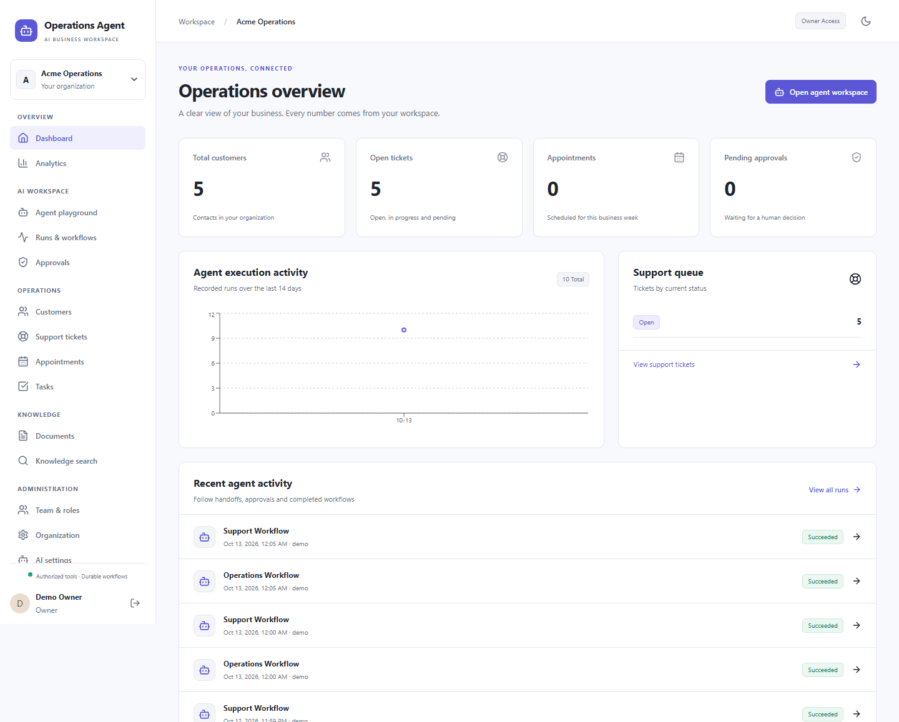

# AI Operations Agent

**Intelligent business operations powered by autonomous AI workflows.**

[](https://github.com/MDCran/ai-operations-agent/actions/workflows/ci.yml)


A working operations platform built with React, FastAPI, LangChain, LangGraph and PostgreSQL. Agents retrieve company knowledge, create support tickets, manage customers and tasks, and book appointments through validated business tools. Protected actions pause for human approval and resume from durable checkpoints.

This is a self-hosted portfolio application and a foundation for further product development. It is not a claim of independently audited production readiness.



## Run locally

Requires Docker with Compose. Ports 8080, 8000, 55432 and 56379 must be free. Database and Redis ports bind only to localhost.

```sh
git clone https://github.com/MDCran/ai-operations-agent.git
cd ai-operations-agent
cp .env.example .env
# On PowerShell: Copy-Item .env.example .env
# Edit .env: replace POSTGRES_PASSWORD, its matching DATABASE_URL password, and DEMO_PASSWORD.
docker compose up --build -d
docker compose run --rm api uv run --no-sync python -m app.db.seed
```

Open **http://localhost:8080** and sign in with `DEMO_EMAIL` and `DEMO_PASSWORD` from your `.env`. The seed creates an owner, an organization, weekday hours and a 30-minute consultation type. Business records start empty. API documentation: **http://localhost:8000/docs**. Health: **http://localhost:8000/health**.

The default local credentials in `.env.example` are for local evaluation only; use your own values. Demo seeding refuses to run with `ENVIRONMENT=production`. Never expose the local demo publicly with shared credentials.

```sh
docker compose logs --tail=100 api worker
docker compose stop
docker compose start
```

PostgreSQL, Redis and uploaded files use named volumes; stopping the stack preserves them.

## Try the workflows

1. Create a customer in **Customers**. Edit the email, notes or status. The original record stays unchanged until an owner or admin reviews **Approvals**. The worker resumes the graph and records the write.
2. Upload a TXT, Markdown, PDF or DOCX document in **Documents**. Wait for `ready`, then inspect passages in **Knowledge search** or ask the playground a question. Sources include real document/chunk identifiers and PDF page numbers when available.
3. Enter `Create ticket: Invoice not received` or `Create task: Follow up with support` in the playground. Inspect the persisted record and **Runs & workflows**.
4. Create an appointment by selecting a customer, appointment type, business date and available slot. Overlapping bookings are rejected by PostgreSQL, including concurrent requests. Cancellation requires approval.

The offline **demo provider** implements explicit commands and deterministic lexical hash vectors. It does **not** pretend to be a language model or semantic embedding service. Ordinary questions use local document retrieval; free-form actions need OpenAI mode. Exact tool commands also work:

```text
List open tickets
List tasks
/tool search_customers {"query":"Acme"}
/tool get_business_information {}
/tool create_customer {"first_name":"Ada","email":"ada@example.com"}
/tool check_appointment_availability {"date":"2030-01-02","appointment_type_id":"YOUR_TYPE_ID"}
```

Use actual IDs returned by your workspace. The validated tool catalog is available at `/api/v1/agents/tools`. The scheduling example date is illustrative; use a future business day.

## Enable OpenAI

Set these server-side environment values, then recreate services:

```dotenv
AI_PROVIDER=openai
OPENAI_API_KEY=your-server-side-key
CHAT_MODEL=gpt-4.1-mini
EMBEDDING_MODEL=text-embedding-3-small
```

```sh
docker compose up -d --force-recreate api worker scheduler
```

OpenAI mode uses structured Pydantic plans and answers through LangChain. A server-enforced tool allowlist, RBAC, tenant filters and deterministic approval gates remain authoritative. Model requests have timeouts and bounded retries. Re-upload demo documents after switching embedding providers; incompatible vectors are excluded from search. The schema uses 1536-dimensional embeddings.

Optional LangSmith tracing uses the standard `LANGSMITH_TRACING`, `LANGSMITH_API_KEY` and `LANGSMITH_PROJECT` environment variables. It is off by default. Review [privacy and retention](docs/privacy.md) before enabling external traces. Model cost is reported only when both per-million token prices are configured; no hard-coded current pricing is assumed.

## What is implemented

| Capability | Implementation |
| --- | --- |
| Agent orchestration | Supervisor and four role-scoped LangGraph nodes, typed plans, conditional routing, recorded steps |
| Durable approvals | PostgreSQL checkpoints, `interrupt`, `Command(resume=...)`, 24-hour expiry, approval decisions and cancellation |
| Exactly-once business effects | Transactional idempotency receipts and audits, per-run/per-key advisory locks, duplicate resume protection |
| CRM, support and tasks | Real CRUD, search, filters, sorting, pagination, ticket assignment/comments, evidence-based response drafting |
| Scheduling | UTC instants, IANA business time zone, configurable hours, availability, booking/rescheduling/cancellation, GiST exclusion constraint |
| RAG | Background ingestion, typed retrieval, pgvector storage, tenant/metadata filters, similarity thresholds, citations and source inspection |
| Workspace | Persistent conversations, event streaming, routing/tool inspector, approvals and failed-run retry |
| Security | Argon2 passwords, expiring revocable sessions, HttpOnly cookies, CSRF tokens, origin checks, RBAC, Redis rate limits |
| Observability | Stored run status, duration, token usage, tool counts, real dashboard aggregates, redacted audit metadata |
| Dashboard | Responsive light/dark UI, Radix primitives, shadcn-style components, TanStack Query, accessible forms, real empty/error states |
| Evaluation | Ten-case routing dataset and deterministic integration regressions; live provider harness available |
| Deployment | Non-root container images, migrations, worker/scheduler, Compose, GitHub Actions, AWS task template and deployment guide |

SSE streams workflow progress and the completed answer. It does not simulate token streaming. Conversation context is bounded to twelve recent messages, each truncated to 1500 characters; there is no long-term semantic memory or automatic summarization pipeline yet.

## Validation

Backend integration tests use **real PostgreSQL/pgvector and Redis** in an isolated temporary stack:

```sh
docker compose -f compose.test.yml up --build --abort-on-container-exit --exit-code-from tests
docker compose -f compose.test.yml down
```

For the browser suite, first start and seed the local demo stack. The test creates synthetic records in that stack; use a disposable demo organization.

```sh
cd apps/web
npm ci
npx playwright install chromium
npm run build
npm run test:e2e
```

Backend checks cover cross-organization isolation, unauthorized tools, CSRF, duplicate writes, approval restarts/rejection/expiry/tampering/stale records/permission revocation, concurrent resumes, concurrent bookings, document deletion, citations and persistent chat effects. Browser checks cover the complete customer → approval → knowledge → ticket → booking flow, navigation, dark mode and mobile layouts. The screenshots show actual records created by that test, not fabricated chart data.

OpenAI behavior requires a configured API key and a separate live evaluation. Offline tests verify orchestration and business invariants; they do not establish production model quality.

## Development and documentation

Python 3.12 and Node 22 are used in containers and CI. Exact compatible dependencies are committed in `apps/api/uv.lock` and `apps/web/package-lock.json`.

```sh
cd apps/api
uv sync --frozen
# Set DATABASE_URL and REDIS_URL to your local services when running outside Docker.
uv run uvicorn app.main:app --reload --port 8000
```

In a second terminal, run `npm ci` and `npm run dev` from `apps/web`. Vite proxies `/api` to port 8000. On Windows, Docker is recommended if host application policies block native Python DLLs.

- [Architecture and design decisions](docs/architecture.md)
- [API and streaming contract](docs/api.md)
- [Permissions and security boundaries](SECURITY.md)
- [Deployment and backup operations](docs/deployment.md)
- [Privacy and retention](docs/privacy.md)
- [Evaluation guide](evaluation/README.md)
- [Contribution guide](CONTRIBUTING.md)

Calendar-provider synchronization, email delivery, document OCR, SSO, password reset, an invitation-acceptance flow, general scheduled automations, resource-specific multi-calendar scheduling and an evaluations dashboard are not implemented. Their absence is explicit; there are no placeholder navigation screens claiming those features.

Licensed under [MIT](LICENSE).
