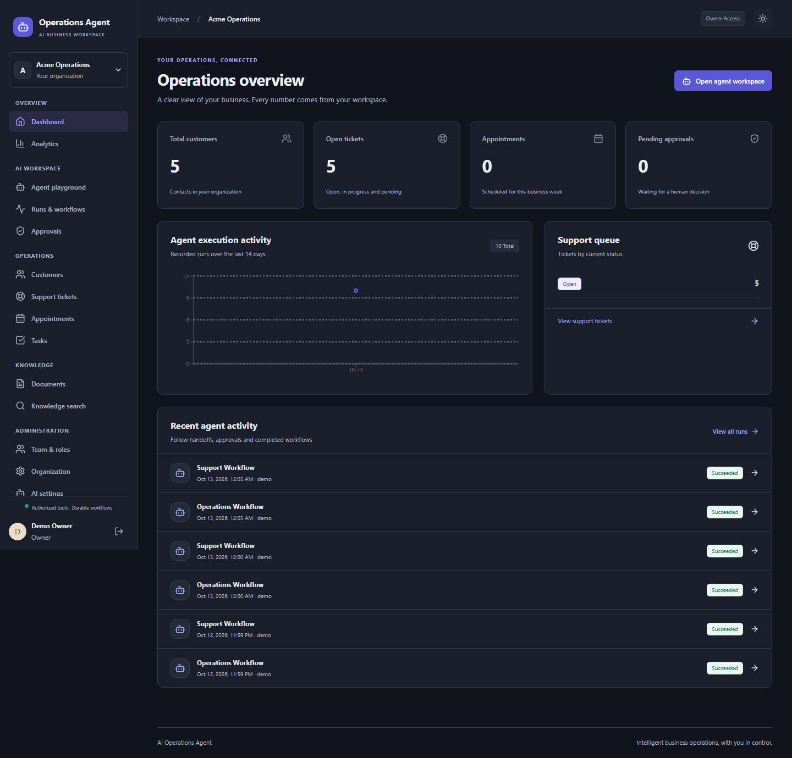

# ai-operations-agent

[](https://github.com/MDCran/ai-operations-agent/actions/workflows/ci.yml) [](LICENSE)

An AI operations workspace for customer support, business knowledge, task management and appointment booking. LangGraph agents use validated business tools and pause protected changes for human approval before execution.

This is a self-hosted portfolio project and a foundation for further development; it has not been independently audited for production readiness.

## Highlights

- Manage customers, support tickets, tasks and appointments in one responsive workspace.
- Ingest PDF, DOCX, Markdown and text documents, then search with source citations.
- Run persistent LangGraph workflows with resumable human approvals and audited tool calls.
- Configure business hours, appointment types, team roles and approval policies.
- Review workflow status, usage, analytics and audit events from the dashboard.
- Run locally with a deterministic demo provider or configure OpenAI for live model calls.

## App screenshots

These captures show the Operations Desk dashboard in both color themes.

### Light theme


### Dark theme



## Stack

- **Frontend:** React 19, TypeScript, Vite, Tailwind CSS, TanStack Query, React Hook Form, Zod and Recharts.
- **API:** Python 3.12, FastAPI, Pydantic 2 and SQLAlchemy 2.
- **Agents:** LangChain and LangGraph, with PostgreSQL-backed workflow checkpoints.
- **Data and jobs:** PostgreSQL with pgvector, Redis, Celery workers and a scheduler.
- **Delivery:** Docker Compose, Alembic migrations and GitHub Actions.

## Getting started

Requirements: Docker with Compose. The app uses ports 8080 and 8000; PostgreSQL and Redis bind to localhost on ports 55432 and 56379.

```powershell
git clone https://github.com/MDCran/ai-operations-agent.git
cd ai-operations-agent
Copy-Item .env.example .env
```

Edit `.env` and replace `POSTGRES_PASSWORD`, the matching password in `DATABASE_URL`, and `DEMO_PASSWORD`. Then start the services and create the demo owner:

```powershell
docker compose up --build -d
docker compose run --rm api uv run --no-sync python -m app.db.seed
```

Open [http://localhost:8080](http://localhost:8080) and sign in with `DEMO_EMAIL` and `DEMO_PASSWORD` from `.env`. The seed creates an owner, an organization, weekday hours and a 30-minute consultation type. Business records start empty. API documentation is at [http://localhost:8000/docs](http://localhost:8000/docs); health checks are at [http://localhost:8000/health](http://localhost:8000/health).

The example credentials are for local evaluation only. Choose your own values and never expose a demo environment with shared credentials. Seeding refuses to run with `ENVIRONMENT=production`.

## Configuration

The default `AI_PROVIDER=demo` supports explicit commands and deterministic local retrieval. It does not emulate a language model. To use OpenAI, set these server-side values in `.env`:

```dotenv
AI_PROVIDER=openai
OPENAI_API_KEY=your-server-side-key
```

The example file also provides `CHAT_MODEL` and `EMBEDDING_MODEL` settings. Recreate the API, worker and scheduler after changing provider settings:

```powershell
docker compose up -d --force-recreate api worker scheduler
```

Re-upload documents after switching embedding providers because stored vectors may be incompatible. LangSmith tracing is off by default; review [privacy and retention](docs/privacy.md) before enabling external tracing.

## Workflows

1. Create a customer in **Customers**. Changes to protected fields wait in **Approvals** until an owner or admin approves them.
2. Upload a document in **Documents**, wait until it is ready, then inspect its passages in **Knowledge search** or ask the agent a question.
3. Ask the playground to create a support ticket or task, then review the record and its workflow details.
4. Book an appointment by choosing a customer, appointment type, business date and available time. The database rejects overlapping bookings, including concurrent requests.

The demo provider recognizes explicit commands such as `List open tickets` and `/tool search_customers {"query":"Acme"}`. The validated tool catalog is available at `/api/v1/agents/tools`. Use real IDs returned by your workspace for commands that need them.

## Architecture

| Area                       | Entry point                                                                                    |
| -------------------------- | ---------------------------------------------------------------------------------------------- |
| Web application            | [`apps/web`](apps/web)                                                                         |
| API routes and schemas     | [`apps/api/app/api`](apps/api/app/api), [`apps/api/app/schemas`](apps/api/app/schemas)         |
| Agent workflows and tools  | [`apps/api/app/workflows`](apps/api/app/workflows), [`apps/api/app/tools`](apps/api/app/tools) |
| Data models and migrations | [`apps/api/app/models`](apps/api/app/models), [`apps/api/alembic`](apps/api/alembic)           |
| Local services             | [`docker-compose.yml`](docker-compose.yml)                                                     |
| Isolated integration tests | [`compose.test.yml`](compose.test.yml)                                                         |
| Deployment template        | [`infrastructure/ecs-api-task.json`](infrastructure/ecs-api-task.json)                         |

## Useful commands

| Command                                                                                          | Purpose                                                             |
| ------------------------------------------------------------------------------------------------ | ------------------------------------------------------------------- |
| `docker compose up --build -d`                                                                   | Build and start the application                                     |
| `docker compose logs --tail=100 api worker`                                                      | Inspect API and worker logs                                         |
| `docker compose stop`                                                                            | Stop services while preserving data                                 |
| `docker compose start`                                                                           | Restart stopped services                                            |
| `docker compose -f compose.test.yml up --build --abort-on-container-exit --exit-code-from tests` | Run backend integration tests against isolated PostgreSQL and Redis |
| `npm ci --prefix apps/web`                                                                       | Install web dependencies                                            |
| `npm run build --prefix apps/web`                                                                | Build the production web app                                        |
| `npm run test:e2e --prefix apps/web`                                                             | Run the browser workflow test against the local demo stack          |

## Security and privacy

The API uses Argon2 password hashes, revocable sessions, CSRF protection, role checks, tenant-scoped data access, rate limits and audited writes. Uploads and credentials are excluded from Git. The demo provider is useful for local evaluation; a live OpenAI configuration sends prompts and retrieved context to the configured provider. Read [SECURITY.md](SECURITY.md) and [docs/privacy.md](docs/privacy.md) before connecting sensitive data or external services.

## Validation

The backend suite runs against real PostgreSQL/pgvector and Redis in an isolated temporary stack. It covers tenant isolation, authentication, approval recovery, duplicate writes, concurrent bookings, document retrieval and citations. The browser test covers customer updates with approval, document ingestion, agent ticket creation, appointment booking, navigation, theme switching and mobile layout.

```powershell
docker compose -f compose.test.yml up --build --abort-on-container-exit --exit-code-from tests
docker compose -f compose.test.yml down
```

OpenAI mode requires a configured API key and separate live evaluation. Offline tests verify workflow and business invariants; they do not measure production model quality. Calendar-provider sync, email delivery, OCR, SSO, password reset and general scheduled automations are not implemented.

## Documentation

- [Architecture and design decisions](docs/architecture.md)
- [API and streaming contract](docs/api.md)
- [Deployment and backup operations](docs/deployment.md)
- [Privacy and retention](docs/privacy.md)
- [Evaluation guide](evaluation/README.md)
- [Contribution guide](CONTRIBUTING.md)

## Ownership

Built and maintained by [MDCran](https://github.com/MDCran). Licensed under [MIT](LICENSE).
