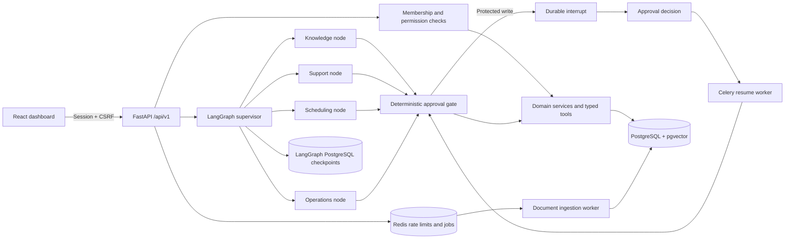

# Architecture

## Boundaries

HTTP controllers validate requests and obtain the actor from a server-side session. The client cannot choose its role or tenant. Repository operations always filter by the actor's organization; composite foreign keys also prevent cross-tenant customer/ticket/appointment links. Passwords, session hashes, storage keys and embeddings are omitted from public serializers.

Domain services enforce business hours, resource transitions, assignment membership and write auditing. Agent tools call these same services. The agent has no SQL tool, shell tool or arbitrary database access. The workflow engine reads execution metadata and resource revision counters for deterministic approval checks, rather than letting the model read database tables.

The supervisor creates a bounded structured plan. Four graph nodes represent separate business responsibilities and tool allowlists. They share the configured provider and typed state; they are not four independently running servers. Each route and handoff is recorded in `agent_steps`. Tools validate arguments and outputs with Pydantic, and enforce permissions again at execution time.

The support path searches knowledge and opens a real unresolved ticket when its plan contains only retrieval calls and retrieval returns no evidence. Explicit create-ticket plans preserve customer associations supplied in the validated tool arguments. The scheduling path uses typed lookup, availability and booking tools. When the model lacks an ID or a selected time, it must request information or use a read tool; it must not invent a booking.

## Persistence and recovery

Conversation messages are business history. `agent_runs` is the workflow instance and monitoring record; a second equivalent workflow-instance table would be redundant. LangGraph checkpoint tables hold execution state separately. Document chunks hold embeddings alongside source metadata; an equivalent embedding-record table would add no useful boundary here.

Each run uses its UUID as the LangGraph thread ID. The workflow pauses with [`interrupt`](https://docs.langchain.com/oss/python/langgraph/interrupts), and resume uses `Command(resume=...)`. [`PostgresSaver`](https://docs.langchain.com/oss/python/langgraph/persistence) persists checkpoints. Schema initialization runs `setup()` outside normal requests.

A protected action has one immutable tool name, validated arguments, a canonical SHA-256 payload digest and, for existing resources, a revision counter. The gate creates a single approval per run before interrupting. The server ignores the supplied resume boolean as authority and rereads the persisted approval decision. The executor locks the approval and resource, checks expiry, the reviewed digest, organization, requester and revision, and rechecks current membership permissions.

The business mutation, audit metadata, execution receipt and approval `executed` transition commit in one database transaction. Transaction-level advisory locks serialize identical idempotency keys; a separate session-level lock serializes graph execution across API and worker processes. PostgreSQL deadlock/serialization failures retry the complete transaction up to twice. A process dying after the business commit can replay the graph node and reuse its receipt without repeating the business effect.

Celery tasks acknowledge late. A scheduler scans persisted queued documents, stale running workflows and decided/expired approvals every minute. It recovers dispatch failures and process interruption; the scheduler is the outbox recovery mechanism. Model invocation itself is at-least-once and may incur repeat token usage after a crash. Exactly-once guarantees concern committed local database effects, not external provider billing or future remote APIs.

## Retrieval

File names never determine storage paths; uploads receive random storage keys. The worker checks PDF encryption/page count, DOCX expanded size and chunk count. It extracts PDF pages or UTF-8/Word text, normalizes whitespace, chunks with overlap, embeds in bounded batches and commits source-associated vectors. Failed ingestion exposes a safe error code and can be retried. Deletion locks the same document row used by ingestion; cascading foreign keys remove all chunks before file removal.

Retrieval is a tenant-filtered cosine-distance query with document filtering, top-K and threshold controls. An HNSW index is provisioned for future larger deployments; this version deliberately uses an exact tenant-filtered scan to avoid approximate post-filter starvation. Semantic mode uses OpenAI embeddings; demo mode uses reproducible lexical hashing. Provider/model metadata prevents comparing incompatible vectors.

Retrieved text enters only the final-answer stage as untrusted evidence. It cannot change tool plans or permissions. Unknown citation IDs are rejected; evidence without model citations produces a safe inspection message. Prompt-injection language is a defense in depth measure, while deterministic authorization and separation from tool planning form the actual action boundary.

## Tradeoffs

- One shared internal booking calendar per organization is enforced by a GiST exclusion constraint over UTC half-open intervals. Multi-staff/resource calendars need a resource key in that constraint.
- Synchronous graph execution produces SSE node events; approvals resume on workers. A disconnect does not guarantee client-visible completion. Persisted run inspection and stale-run recovery are authoritative.
- Histories are bounded and truncated before model use. No hidden long-term memory is claimed.
- Organization settings store business information and configurable approval tools. Business hours and appointment types remain normalized records.
- The frontend keeps session cookies HttpOnly and CSRF tokens in memory. Persistent browser storage holds only the color-theme preference.

Provider implementations follow the [LangChain model and structured-output API](https://docs.langchain.com/oss/python/langchain/models). Exact dependency versions are lockfile-controlled and integration-tested together.
